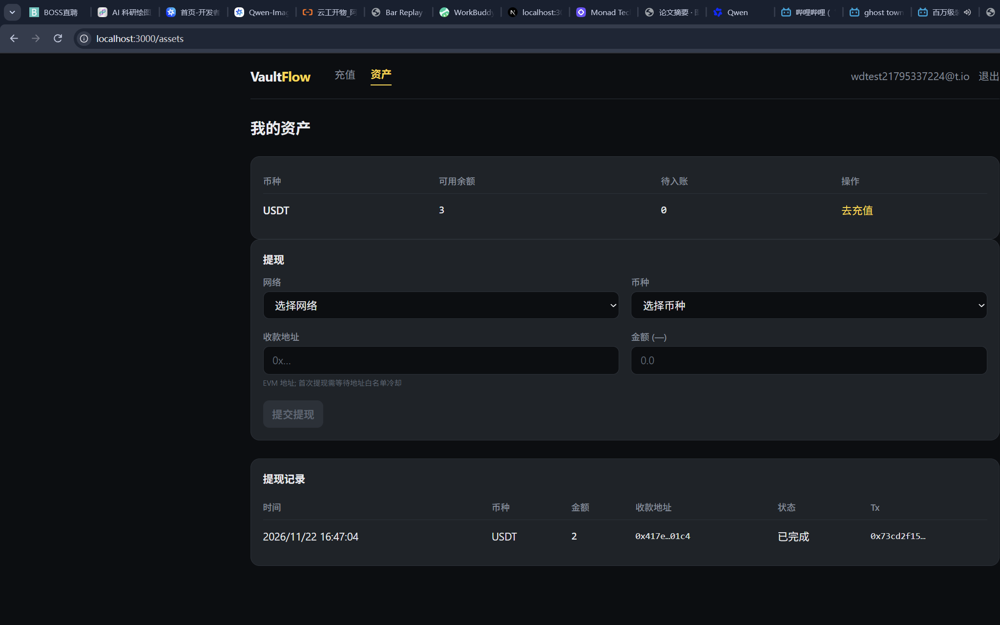
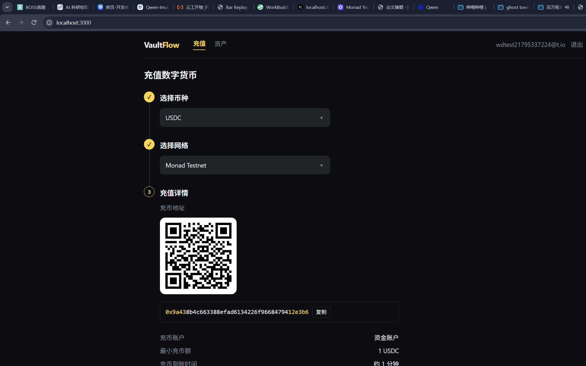

# VaultFlow — 托管式稳定币充提钱包后端

多链 EVM 托管交易所后端：Go 业务网关 + Rust mTLS 隔离签名服务 + Foundry 合约层 + Next.js 前端，PostgreSQL/Redis，Docker Compose 部署。当前支持 **Sepolia (11155111)** 与 **Monad Testnet (10143)**。

## 架构

```
gateway   :8080  公开 REST API (注册/登录/资产/充值地址/余额/提现)
backend   :8081  内部 worker: txmanager + 每链 sweeper + credit worker + withdrawer
indexer   :8082  EVM 扫块器 (confirmations / reorg / canonical 跟踪)
vault-signer :50051  Rust gRPC mTLS 签名金库 (加密 DEK sqlite, 策略裁决)
postgres  :5432
redis     :6379
```

资金流：**充值** → CREATE2 派生 vault（per-user per-chain 确定性地址）→ indexer 检测 → N 确认 → 入账 → sweeper `deployAndSweepBatch` 归集到冷钱包。**提现** → 余额冻结 → signer 白名单租约（Ed25519 管理员签名 + 冷却）→ payout 热钱包 ERC-20 `transfer` → 链上确认 → 核销。

## 部署

### 1. 前置

WSL Ubuntu 内：go / cargo / foundry / node / docker。所有构建与运行均在 WSL 执行：

```bash
wsl -d ubuntu -- bash -ls <<'EOF'
export PATH=$HOME/.foundry/bin:$HOME/.local/node/bin:$HOME/go/bin:$HOME/.cargo/bin:$PATH
cd /mnt/e/workspace/vaultflow
EOF
```

仓库根：`E:\workspace\vaultflow`（Windows）= `/mnt/e/workspace/vaultflow`（WSL）。

### 2. 起栈

```bash
docker compose up -d --build
docker compose ps        # 6 服务全 healthy
```

镜像 `vaultflow-gateway:local` 构建三个 Go 二进制（gateway/backend/indexer）；`deploy/Dockerfile.signer` 构建 Rust signer。migrations 由 gateway 启动时自动应用（`schema_migrations` 记账，幂等）。

### 3. 新链接线（以 Monad 10143 为模板）

每接入一条链需要五步：

```bash
# ① 合约整套部署 (Deploy.s.sol: mock token + Factory + BatchSweeper + Router)
forge script script/Deploy.s.sol --rpc-url $RPC --broadcast \
  --private-key $DEPLOYER_PK --verify false
# → 记 factory / implementation / init_code_hash / sweeper / router

# ② signer 热钱包: relayer+payout 生成密钥, DEK 信封注入 signer.db 的 encrypted_keys 表
#    (参考 deploy/monad-wallets.json 的生成方式; relayer 需充 gas)

# ③ deploy/gateway.env 的 CHAIN_CONFIG_JSON chains 加一条:
#    chain_id/rpc_urls/required_confirmations/eip3009_router/batch_sweeper/
#    relayer_hot_wallet/payout_hot_wallet/cold_wallets/start_height/
#    factory+implementation+init_code_hash (per-chain 覆盖)
#    sweep_gas_base/sweep_gas_item (归集交易 gas, 默认 80k+120k*items)

# ④ deploy/signer-config.json chains 加同样 chain_id (admin_approver_pubkey 全局已有)

# ⑤ DB 种子 + 游标
docker exec vaultflow-postgres psql -U vaultflow -d vaultflow -c "
  INSERT INTO supported_assets (chain_id, asset_symbol, token_contract, decimals, min_deposit) VALUES
    (<cid>, 'USDT', '0x…', 6, 1000000), (<cid>, 'USDC', '0x…', 6, 1000000);
  INSERT INTO platform_wallets (chain_id, role, address) VALUES
    (<cid>,'RELAYER','0x…'), (<cid>,'PAYOUT','0x…'), (<cid>,'COLD','0x…');
  INSERT INTO chain_sync_cursors (chain_id, latest_synced_height, latest_synced_hash)
    VALUES (<cid>, <start_height-1>, '<该块哈希>');"
```

重启：`docker compose up -d --build --force-recreate gateway backend indexer`。indexer 启动日志应出现 `initCodeHash verified`。

### 4. 关键配置

| 文件 | 内容 |
|---|---|
| `deploy/gateway.env` | `CHAIN_CONFIG_JSON`（每链 RPC/钱包/合约/gas/起始高度）+ `ADMIN_ED25519_PRIVATE_KEY`（提现白名单租约签名） |
| `deploy/signer-config.json` | signer 链配置、admin approver 公钥、冷却/限额策略 |
| `deploy/admin-ed25519.json` | 白名单租约管理员密钥（与 signer-config 公钥配对） |
| `deploy/{sepolia,monad}-*.json` | 各链部署地址与热钱包密钥记录 |

## 操作

### 用户侧 API（JWT）

```bash
TOKEN=$(curl -sS -X POST :8080/v1/auth/register -d '{"email":"a@b.c","password":"pw"}' | jq -r .token)
curl :8080/v1/assets                                          # 支持的资产/链
curl :8080/v1/me/deposit-address/10143 -H "Authorization: Bearer $TOKEN"
curl :8080/v1/me/balances       -H "Authorization: Bearer $TOKEN"   # 按币种跨链聚合
curl :8080/v1/me/deposits       -H "Authorization: Bearer $TOKEN"
```

### 提现 API

```bash
curl -X POST :8080/v1/me/withdrawals \
  -H "Authorization: Bearer $TOKEN" -H 'Content-Type: application/json' \
  -H 'Idempotency-Key: <uuid>' \
  -d '{"chain_id":10143,"token_symbol":"USDT",
       "to_address":"0x…","amount":"2000000"}'    # amount=原子单位字符串
curl :8080/v1/me/withdrawals -H "Authorization: Bearer $TOKEN"      # 状态查询
```

状态机 `QUEUED→WHITELISTED(冷却60s)→IN_FLIGHT→CONFIRMED`；失败自动退款回 `available`。同 `Idempotency-Key` 重放返回原单，不重复扣款。

### 运维要点

- **payout 钱包必须持有代币库存**（提现实付来源）+ 原生 gas；库存不足 → 链上 revert → 自动退款，不会卡住。
- **relayer 钱包只需原生 gas**（归集交易的 signer）。
- **indexer 追赶慢时**可快进游标：停 indexer → `UPDATE chain_sync_cursors SET latest_synced_height=<h>, latest_synced_hash='<真实块哈希>'` + 插 `chain_blocks` 锚定行 → 重启。
- **余额语义**：`user_balances` 按 `(user_id, asset_symbol)` 跨链聚合；链与合约信息只留在 `onchain_deposits`/`withdrawals` 溯源。
- **归集自愈**：sweep 失败 → intent `FAILED` → items `RELEASED` → 自动重建批次重试，无需人工。

### 截图





## 实测数据（Sepolia + Monad e2e，2026-11-22）

**充值/归集**（`onchain_deposits` + `sweep_batches`）：

| 链 | 事件 | 金额(原子) | 状态 | 块高 |
|---|---|---|---|---|
| 11155111 | USER_DEPOSIT | 25,000,000 USDC | CREDITED→SWEPT | 12186789/12187296 |
| 10143 | USER_DEPOSIT | 25,000,000 USDT | SWEPT | 81797022 |
| 10143 | USER_DEPOSIT | 5,000,000 USDT | SWEPT | 81800418 |
| — | sweep_batches ×3 | 25M+5M+25M | COMPLETED | — |

**提现**（`withdrawals`）：

| 链 | 收款 | 金额(原子) | 结果 |
|---|---|---|---|
| 10143 | 0x417E…01C4 | 2,000,000 | FAILED(payout 库存不足→自动退款) |
| 10143 | 0x417E…01C4 | 2,000,000 | CONFIRMED `0x73cd2f15…` |

**链上终态**（`cast call balanceOf`，Monad `0x42D5…d8b58`）：

```
cold  0x4874…5da2   USDT = 30,000,000   (25+5 归集累计)
payout 0x5765…b1a3  USDT = 98,000,000   (mint 100 − 提现 2)
用户  0x417E…01C4   USDT = 2,000,000    (提现到账)
```

**库内余额**：3 个 USDT 行 `30M / 5M / 3M`（跨链按币种聚合）；indexer 游标 `10143→81,811,624 / 11155111→12,188,101`。

## 测试与构建

| 模块 | 命令 |
|---|---|
| Go | `cd services/gateway-core && go build ./...` |
| Rust | `cd services/vault-signer && cargo check --all-targets` |
| 合约 | `cd contracts && forge build` |
| 前端 | `cd web && npm run typecheck`（`cashier-panel`/`dashboard/flows` 遗留报错为商户时代死代码） |

## 目录

```
contracts/                Foundry 合约 (Factory/BatchSweeper/EIP3009Router/mock tokens)
services/gateway-core/    Go 模块: cmd/{gateway,backend,indexer} + internal/{api,store,exchange,
                          indexer,sweeper,txmanager,withdrawer,signerclient,auth,chain,types,ports}
services/vault-signer/    Rust mTLS 签名金库 (engine/grpc/db/kms)
proto/signer/v1/          signer gRPC 冻结契约
deploy/                   gateway.env / signer-config / 密钥与部署记录
migrations/               (在 services/gateway-core/migrations) 编号 SQL, 启动自动应用
web/                      Next.js 用户前端 (注册登录/充值地址/资产/提现)
docs/GOLDEN_VECTORS.json  字节级契约黄金向量; AGENTS.md 为权威规范
```
